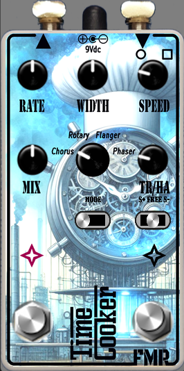

# Time Cooker

**Shape the Movement.**

Four classic modulation effects, endless ways to make them move. Time Cooker brings together Chorus, Rotary, Flanger and Phaser, each offering three distinct modes and intuitive Width, Rate and Mix controls.

But there's more: an integrated dual-mode Tremolo, with Normal and Harmonic modes, adjustable Width and Speed, and selectable Sine or Square waveforms.

Take it even further by synchronizing the Tremolo to the modulation LFO, creating perfectly connected rhythmic movements and evolving textures.

From subtle motion to swirling, pulsating soundscapes, Time Cooker puts time and movement at your fingertips.

**Explore. Craft. Find. Enjoy your own sound!**

This plugin models a real digital pedal that we developed.

Distributed as a free **Windows VST3** plugin by [FMR Labs](https://github.com/FMR-Labs). Built with **iPlug2**.

<p align="center">
  
</p>

> **Note:** FMR Labs is an independent personal project and is not affiliated with FMR Audio.

---

## Features

* Modulation controls: **Rate**, **Width**, **Mix**, **Type**, **Mode**, **Left foot switch**
* Tremolo controls: **Speed**, **TR/HA**, **Synchro**, **Right foot switch**
* Mono or stereo (`1-1`, `2-2`), independent processing per channel
* Star-shaped activation LEDs
* Runs at any host sample rate: the engine works at 48 kHz, with automatic resampling when the host runs at another rate. The resampler latency is reported to the host.
* Lightweight: small algorithmic tasks, no allocation or lock on the audio thread

## How it works

### Modulation
Activated with the **left footswitch**.

| Control | Function |
|---|---|
| Mode | Selects the modulation mode (left = 0, center = 1, right = 2). |
| Rate | LFO speed. |
| Mix | Balance between dry and wet signals. |
| Width | LFO amplitude. |

**Modulation modes:**

| Effect | Mode 0 | Mode 1 | Mode 2 |
|---|---|---|---|
| **Chorus** | 1 tap | 2 taps, phase opposition | 4 taps, sine and cosine at different times |
| **Rotary** | Bass and treble modulated | Treble only | Bass only |
| **Flanger** | Basic | Through-zero | Double through-zero, phase opposition |
| **Phaser** | 2 stages | 6 stages | 12 stages |

**Flanger feedback:**
- Width left of noon: negative feedback.
- Width right of noon: positive feedback.

### Tremolo
Activated with the **right footswitch**.

| Control | Function |
|---|---|
| Speed | LFO speed. Left of noon = sine wave; right of noon = square wave. |
| TR/HA | LFO width. Left of noon = normal mode; right of noon = harmonic mode. |

**Tremolo synchronization modes:**

| Mode | Function |
|---|---|
| **Free** | Tremolo LFO runs independently, with its speed controlled by Speed. |
| **S+** | Tremolo LFO is synchronized with the modulation LFO, in phase. |
| **S-** | Tremolo LFO is synchronized with the modulation LFO, in phase opposition. |

## Signal chain

```
Host (any fs, 1-2 ch)
 → [fs ≠ 48 kHz] resampling → 48 kHz
 → Modulation
 → Tremolo
 → [fs ≠ 48 kHz] resampling → host fs
```

---

## Installation (Windows)

> Binaries will be published on the **[Releases](../../releases)** page. Until then, there is nothing to download.

1. Download the latest `.zip` from the **[Releases](../../releases)** page. It contains the plugin, a `README_FMR_TimeCooker.txt` (installation, license, third-party notices) and the font license file.
2. Extract the `.vst3` file.
3. Copy it into your VST3 folder (usually `C:\Program Files\Common Files\VST3`).
4. Rescan plugins in your DAW.

---

## About this repository (source code notice)

This repository contains the **iPlug2 wrapper and UI** of Neural Preamp: plugin class, parameters, UI layout, resources and CMake project.

* **The DSP engine is closed source and not included.** `CMakeLists.txt`, `TimeCooker.cpp`, `TimeCookerDSP.cpp` and `TimeCookerGUI.cpp` reference it through `../FMR_Library/` (neural network inference, weights, EQ, resampler, pot curves, filters, and a custom UI control). **The project cannot be compiled from this repository alone.**
* **Images are not included** (the knob and background bitmaps). See [THIRD_PARTY.md](THIRD_PARTY.md) for their origin and licenses.
* It is published to share iPlug2 UI and parameter patterns, track issues and host documentation. Pre-compiled binaries will be distributed through GitHub Releases.

### Layout

| File | Role |
|---|---|
| `TimeCooker.h / .cpp` | Plugin class, parameters |
| `TimeCookerDSP.h / .cpp` | Plugin audio callback |
| `TimeCookerGUI.h / .cpp` | Plugin UI |
| `config.h` | iPlug2 plugin configuration (IDs, channels, UI size, resources) |
| `CMakeLists.txt` | iPlug2 CMake project (VST3 target) |
| `resources/` | Windows resources (`main.rc`, `resource.h`); images are not included |

### Building the wrapper structure (reference only)

Requires [iPlug2](https://github.com/iPlug2/iPlug2), CMake ≥ 3.14, a C++20 compiler, and the engine sources placed in `../FMR_Library/`:

```
cmake -B build -DIPLUG2_DIR=<path to iPlug2>
cmake --build build --config Release
```

---

## License

* **Source code in this repository** (iPlug2 UI and wrapper): [MIT License](LICENSE). The MIT license covers the code only. Fonts and images are not part of this repository and keep their own terms, see [THIRD_PARTY.md](THIRD_PARTY.md).
* **Compiled binaries (`.vst3`)**: **Freeware**. Free to use in both personal and commercial music productions. You may redistribute the original, unmodified archive, free of charge. Reverse engineering, decompiling, reselling, or redistributing modified binaries is prohibited.

*VST is a trademark of Steinberg Media Technologies GmbH.*
